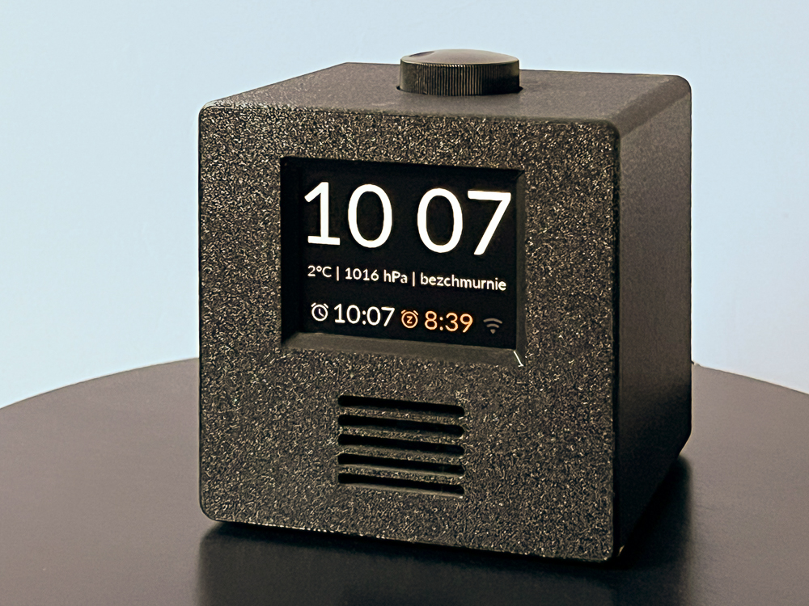
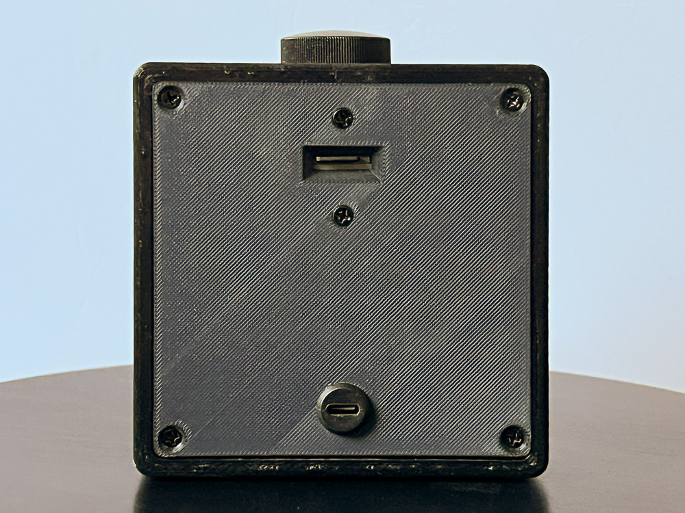

# Budzik na ESP32 z łagodnie narastającym dźwiękiem

<p align="center">
  
  
</p>

Budzik powstał na podstawie projektu [Crescendo Clock](https://github.com/javiser/crescendo-clock), który napisał javiser.
Z oryginału pochodzi pomysł łagodnego alarmu, obsługa jednym pokrętłem i główna część programu
(obsługa alarmu, drzemki i ustawiania budzika, pokrętła i modułu MP3). Zmieniłem płytkę, ekran, czcionki i układ ekranu.
Doszła pogoda, strona ustawień w przeglądarce, jasność zależna od pory dnia i aktualizacja przez Wi-Fi.

## Co potrafi
- Alarm zaczyna grać cicho i stopniowo gra coraz głośniej. Melodia jest z karty microSD.
- Całą obsługę na zegarze robi się jednym pokrętłem, które można też wciskać.
- Godzinę zegar pobiera z internetu, a pogodę z serwisu [Open-Meteo](https://open-meteo.com), który nie wymaga klucza ani konta.
- Ustawienia zmienia się na stronie w przeglądarce, pod adresem `http://budzik.local`.
- Sieć Wi-Fi ustawia się telefonem: zegar włącza własną sieć i pokazuje na ekranie kod QR do połączenia.
- Rano ekran rozjaśnia się płynnie od wschodu słońca, wieczorem przyciemnia się w okolicy zachodu, a w nocy gaśnie.
- Nowe oprogramowanie można wgrać przez Wi-Fi. Jeśli nowa wersja nie działa, zegar wraca do poprzedniej.

## Jak używać
### Ekran
U góry ekranu jest duża godzina. Pod nią jest linia pogody: temperatura, ciśnienie i opis pogody.
W tym samym miejscu zegar pokazuje też krótkie komunikaty. Na dole jest rząd ikon: z lewej ikona budzika
i godzina alarmu, w środku czas do alarmu albo do końca drzemki, z prawej ikona Wi-Fi.

Gdy alarm jest włączony, ikona budzika jest biała, a obok widać godzinę alarmu. Gdy alarm jest wyłączony,
ikona jest szara, a godziny alarmu nie widać. Gdy do alarmu zostało mniej niż 9 godzin, w środku widać
ikonę łóżka i czas, jaki został do alarmu.

Ekran ma trzy poziomy jasności: słaby (nocny), średni i pełny. Może też być zgaszony.

### Pokrętło
Pokrętło można obracać w obie strony i wciskać na trzy sposoby:
- krótko, czyli kliknięcie,
- dwa razy szybko, czyli dwuklik (działa tylko na ekranie z godziną),
- dłużej, ok. 1 sekundy, czyli przytrzymanie.

### Pierwsze uruchomienie i połączenie z Wi-Fi
Zegar nie ma ręcznego ustawiania godziny. Pobiera ją z internetu, więc najpierw trzeba go połączyć z siecią Wi-Fi.

Gdy zegar nie ma zapisanej sieci, przechodzi w tryb ustawień: włącza własną sieć Wi-Fi o nazwie `Budzik-ustawienia`.
Na ekranie pokazuje kod QR, nazwę tej sieci, hasło (8 cyfr, za każdym razem inne) i adres strony.
1. Zeskanuj kod QR telefonem albo połącz się z siecią `Budzik-ustawienia` ręcznie.
2. Otwórz w przeglądarce adres `http://192.168.4.1`.
3. Wybierz swoją sieć z listy, wpisz hasło i kliknij „Zapisz i uruchom zegar ponownie”.

Jeśli wpiszesz błędne hasło, zegar po ponownym uruchomieniu nie połączy się z siecią. Po 2 minutach znowu przejdzie
w tryb ustawień i pokaże na czerwono „błędna nazwa sieci lub hasło”. Tryb ustawień włącza się sam tylko wtedy,
gdy zapisana sieć ani razu nie zadziałała.

Gdy sieć wcześniej działała, a potem zmienisz jej nazwę albo hasło w routerze, zegar sam nie przejdzie w tryb ustawień.
Wtedy włącz go ręcznie: odłącz zasilanie, wciśnij pokrętło, podłącz zasilanie, przytrzymaj pokrętło jeszcze 1-2 sekundy i puść.

W trybie ustawień zegar nie pokazuje godziny. Żeby wrócić do ekranu z godziną, przytrzymaj pokrętło.
Zegar wraca do niego także sam, w dwóch przypadkach:
- Po 10 minutach, jeśli w tym czasie nikt nie korzystał ze strony `192.168.4.1`. Dzieje się tak tylko wtedy,
  gdy zegar ma już zapisaną jakąś sieć Wi-Fi. Bez zapisanej sieci tryb ustawień trwa, aż ją ustawisz.
- O godzinie alarmu. Kod QR znika, a budzik dzwoni jak zwykle.

### Codzienna obsługa
| Co jest na ekranie    | Obrót                          | Kliknięcie                                       | Przytrzymanie                          |
|-----------------------|:------------------------------:|:------------------------------------------------:|:--------------------------------------:|
| Godzina               | rozjaśnia ekran na 3 s         | włącza albo wyłącza alarm (w nocy najpierw rozjaśnia ekran, opis niżej) | zaczyna ustawianie godziny alarmu |
| Ustawianie alarmu     | zmienia godzinę lub minuty     | przechodzi z godzin do minut, potem zapisuje     | anuluje, zostaje poprzednie ustawienie |
| Alarm dzwoni          | nic                            | drzemka                                          | nic                                    |
| Drzemka               | 1. i 3. krok wyłączania alarmu (opis niżej) | rozjaśnia ekran                     | 2. krok wyłączania alarmu              |
| Tryb ustawień (kod QR) | nic                           | nic                                              | wyjście z trybu ustawień               |

Po dwukliku zegar pokazuje przez 10 sekund, w linii pogody, adres strony ustawień (`budzik.local` i adres IP).
Gdy zegar zna godzinę, ale nie ma połączenia z Wi-Fi, zamiast adresu pokazuje podpowiedź „trzymaj pokrętło przy włączaniu”,
czyli jak ręcznie włączyć tryb ustawień.

#### Ustawianie alarmu
- Po zapisaniu nowej godziny alarm jest zawsze włączony.
- Jeśli przez 30 sekund nie ruszysz pokrętłem, ustawianie się kończy bez zapisu i zostaje poprzednia godzina.

#### Włączanie i wyłączanie alarmu w nocy
- Gdy ekran świeci słabo albo jest zgaszony, pierwsze kliknięcie tylko go rozjaśnia. Alarm przełącza dopiero następne
  kliknięcie, w ciągu 3 sekund. Dzięki temu trudniej wyłączyć budzik przez przypadek po ciemku.
- Nie klikaj drugi raz zaraz po pierwszym. Dwa szybkie kliknięcia zegar uzna za dwuklik i pokaże adres strony.

#### Drzemka
- Kliknięcie w czasie dzwonienia włącza drzemkę na 5 minut. Długość drzemki możesz zmienić na stronie, od 5 do 9 minut.
- Po drzemce alarm dzwoni znowu, zaczynając cicho, tak jak za pierwszym razem. Drzemek może być dowolnie dużo.
- Żeby wyłączyć alarm w czasie drzemki, zrób trzy ruchy, każdy najwyżej 3 sekundy po poprzednim: obróć pokrętło
  w jedną stronę, wciśnij je i przytrzymaj ok. 1 sekundy, a potem obróć w drugą stronę. Po pierwszym ruchu nad rzędem
  ikon pojawia się pomarańczowa kreska w lewej połowie ekranu, po drugim w prawej.

#### Kiedy budzik sam się wyłącza
- Po wyłączeniu alarmu w czasie drzemki budzik zostaje wyłączony.
- Gdy nikt nie zareaguje na alarm, po 20 minutach dźwięk się urywa i budzik też zostaje wyłączony.
- W obu przypadkach następnego dnia budzik nie zadzwoni. Włącz go kliknięciem.

#### Zanik prądu
- Zegar nie ma baterii, która pamiętałaby godzinę. Po zaniku prądu pokazuje „--:--” i nie dzwoni, dopóki nie pobierze
  godziny z internetu. Inaczej mógłby zadzwonić o złej porze.
- W linii pogody widać wtedy, na co zegar czeka, np. „pobieram godzinę z sieci...”. Gdy alarm jest włączony,
  a Wi-Fi nie działa, napis jest czerwony: „brak sieci, alarm nie zadzwoni”.
- Po minucie ekran gaśnie. Obrót pokrętła albo kliknięcie znowu go rozjaśnia, a każde kolejne trochę bardziej.
  Gdy ekran świeci już średnio albo jasno, kliknięcie przełącza alarm, tak jak na zwykłym ekranie z godziną.
- Zanik prądu nie wyłącza budzika. Gdy zegar pobierze godzinę, alarm działa tak jak przedtem.

#### Dźwięk i pogoda
- Czerwona ikona głośnika w lewym dolnym rogu, w miejscu ikony budzika, oznacza brak dźwięku: moduł MP3 nie odpowiada
  albo na karcie nie ma plików. Zegar sprawdza to ok. 30 sekund po włączeniu, a potem co godzinę.
- Pogodę zegar pobiera co 30 minut. Jeśli przez 2 godziny nie uda się jej pobrać, zegar zamiast starych danych pokazuje
  „brak danych pogodowych”. Gdy Wi-Fi nie działa od 3 godzin, pokazuje „brak Wi-Fi od kilku godzin”.

### Strona ustawień
W sieci domowej strona jest pod adresem `http://budzik.local`. Jeśli ten adres nie działa, użyj adresu IP,
który zegar pokazuje po dwukliku. Strona działa na telefonie i na komputerze.

Na górze strony widać stan połączenia Wi-Fi, aktualną pogodę i alarm: o której zadzwoni, za ile, czy właśnie dzwoni
albo do kiedy trwa drzemka. Godzinę alarmu ustawisz tylko pokrętłem na zegarze.

Niżej możesz zmienić jasność ekranu, długość drzemki, rodzaj pokazywanej temperatury i miejscowość, a także obejrzeć
stan zegara i wgrać nowe oprogramowanie.

Jasność ustawiasz dla czterech pór doby:
- Noc: od wybranej godziny do wschodu słońca ekran jest zgaszony.
- Rano: od wschodu słońca ekran rozjaśnia się płynnie przez 1 do 3 godzin, do pełnej jasności.
  Pełną jasność osiąga nie wcześniej niż o wybranej godzinie.
- Wieczór: od wybranej chwili w okolicy zachodu słońca (do wyboru od godziny przed zachodem do godziny po nim)
  ekran przez 30 minut przyciemnia się płynnie do średniej jasności.
- Przed snem: od wybranej godziny ekran świeci słabo.

Wykres na stronie pokazuje, jak zmienia się jasność dziś, 21 czerwca i 21 grudnia. Godziny wschodu i zachodu słońca
zegar liczy sam ze współrzędnych miejscowości.

Zegar może pokazywać temperaturę powietrza albo temperaturę odczuwalną. Obie pochodzą z Open-Meteo.

Miejscowość do pogody wyszukasz po nazwie. Wyniki pokazują gminę, powiat i województwo, żeby łatwo odróżnić
miejscowości o tej samej nazwie. Możesz też wpisać współrzędne ręcznie. Dopóki nie wybierzesz miejscowości,
zegar pokazuje pogodę dla Warszawy.

W części „Stan zegara” widać wersję oprogramowania, czas pracy od włączenia, przyczynę ostatniego uruchomienia,
wolną pamięć, siłę sygnału Wi-Fi, godzinę na zegarze, kiedy pobrano pogodę i czy działa dźwięk.

Sieć Wi-Fi zmienisz tylko w trybie ustawień, czyli w sieci `Budzik-ustawienia`. Na stronie w sieci domowej tej opcji nie ma.

### Karta SD i melodia
W repozytorium nie ma melodii, bo utwory zwykle są chronione prawem autorskim. Przygotuj własną melodię i kartę microSD:
- Melodia może być dowolnym plikiem MP3. Darmowe dźwięki znajdziesz np. na [freesound.org](https://freesound.org).
- Sformatuj kartę jako FAT32.
- Skopiuj na kartę, do głównego katalogu, jeden plik o nazwie `0001.mp3`.
- Jeśli na karcie jest więcej plików, pamiętaj, że moduł MP3 numeruje je w kolejności kopiowania na kartę, a nie według nazwy.
  Zegar gra w kółko utwór o numerze `melody_nr` (domyślnie 1), ustawionym w pliku [src/clock_machine.hpp](src/clock_machine.hpp).

Więcej o przygotowaniu karty: [instrukcja modułu DFPlayer Mini](https://wiki.dfrobot.com/DFPlayer_Mini_SKU_DFR0299).
W obudowie ze zdjęć gniazdo karty jest z tyłu, więc kartę wymienisz bez otwierania zegara.

W tym samym pliku [src/clock_machine.hpp](src/clock_machine.hpp) są ustawienia głośności alarmu. Alarm zaczyna bardzo cicho
(głośność 5) i co 3 sekundy gra o stopień głośniej (`crescendo_factor` = 6 kroków po pół sekundy), aż po ok. 45 sekundach
dojdzie do `max_alarm_volume` = 20. Moduł ma 30 stopni głośności. Te wartości zmienisz tylko w kodzie.

## Części
- płytka ESP32 z modułem ESP32-WROOM (`esp32dev`, 4 MB pamięci flash),
- ekran 2,8" 240×320 ze sterownikiem ST7789 (SPI),
- enkoder obrotowy z przyciskiem, z własnymi rezystorami podciągającymi (pin 35 ESP32 nie ma wbudowanych),
- moduł MP3 [DFRobot DFPlayer Mini](https://www.dfrobot.com/product-1121.html) z kartą microSD,
- mały głośnik,
- zasilanie 5 V przez USB.

Podłączenie (piny są w pliku [src/clock_common.hpp](src/clock_common.hpp)):

| Element       | Piny ESP32 |
|---------------|------------|
| Ekran ST7789  | MOSI 23, SCLK 18, DC 4, CS 5, podświetlenie 14; RST i MISO niepodłączone |
| Enkoder       | A 35, B 33, przycisk 32 |
| DFPlayer      | GPIO 17 (TX ESP32) do RX DFPlayera, GPIO 16 (RX ESP32) do TX DFPlayera |

Obudowa ze zdjęć pasuje do ekranu 2,8" ST7789. Pliki do druku są na Printables:
[Clock case for 2.8" ST7789](https://www.printables.com/model/1495132-clock-case-for-28-st7789).

## Kompilacja i wgrywanie
Przyda się podstawowa znajomość PlatformIO i ESP32. Projekt jest kompilowany i sprawdzany w systemie Windows.
Na Linuksie i macOS nie był sprawdzany.

Potrzebujesz Visual Studio Code z rozszerzeniem PlatformIO albo samego PlatformIO Core (wiersz poleceń).
Projekt używa platformy [pioarduino 55.03.37](https://github.com/pioarduino/platform-espressif32)
z ESP-IDF 5.5.2 (oficjalne narzędzia firmy Espressif do ESP32).

W systemie Windows kompiluj w PowerShellu (w VS Code wybierz terminal PowerShell), a nie w Git Bash.
Narzędzia ESP-IDF nie instalują się pod Git Bash.

Wgranie przez USB:
```bash
pio run -t upload
```
Wgranie przez USB zapisuje też podział pamięci z dwoma miejscami na program ([partycje_ota.csv](partycje_ota.csv)).
Później kolejne wersje możesz wgrywać przez Wi-Fi.

W [platformio.ini](platformio.ini) jest ustawione wolne wgrywanie (`upload_speed = 115200`), bo u autora szybsze
się przerywało. Jeśli u ciebie szybsze wgrywanie działa, możesz tę wartość zwiększyć.

Strefa czasowa jest wpisana w kod na stałe: czas środkowoeuropejski z przejściem na czas letni, jak w Polsce.
W innej strefie trzeba zmienić ustawienie `TZ` w pliku [src/wifi_time.cpp](src/wifi_time.cpp).

### Aktualizacja przez Wi-Fi
Nową wersję wgrasz na stronie zegara, w części „Aktualizacja oprogramowania”: wybierz plik
`.pio/build/esp32dev/firmware.bin`. Możesz też wgrać ją z komputera poleceniem (w systemie Windows `curl.exe`,
na Linuksie i macOS `curl`):
```bash
curl.exe -H "X-Budzik: 1" --data-binary "@.pio/build/esp32dev/firmware.bin" http://budzik.local/api/aktualizacja
```
Po aktualizacji nowa wersja jest próbna. Jeśli zegar połączy się z Wi-Fi i strona działa, po minucie nowa wersja
zostaje na stałe. Jeśli zegar uruchomi się ponownie przed upływem tej minuty albo przez 10 minut nie połączy się
z Wi-Fi, wraca do poprzedniej wersji.

Zegar nie przyjmie aktualizacji, gdy alarm dzwoni, trwa drzemka albo alarm ma zadzwonić w ciągu 3 minut.

Numer wersji na stronie pochodzi z tagów Gita (`v2.0`, `v2.1`, `v2.1.1` itd.). Zapisuje go skrypt [wersja.py](wersja.py)
przy każdej kompilacji. Gdy projekt jest pobrany bez Gita, np. jako plik ZIP, strona pokaże wersję „nieznana”.

## Podziękowania
- [javiser](https://github.com/javiser), autor oryginalnego [Crescendo Clock](https://github.com/javiser/crescendo-clock).
  W jego README są też podziękowania dla projektów, z których korzystał.
- [LovyanGFX](https://github.com/lovyan03/LovyanGFX): biblioteka do rysowania na ekranie.
- [Open-Meteo](https://open-meteo.com): dane pogodowe i wyszukiwanie miejscowości (licencja CC BY 4.0).
- Czcionka [Lato](https://www.latofonts.com) i ikony [Material Design Icons](https://pictogrammers.com/library/mdi/).
- Wzór na wschód i zachód słońca: amerykańska agencja NOAA.

## Licencja
Program jest udostępniany na licencji MIT, tak jak oryginał (Copyright (c) 2022 javiser). Szczegóły są w pliku [LICENSE](LICENSE).
Czcionka Lato ma licencję SIL Open Font License ([fonts/Lato-OFL.txt](fonts/Lato-OFL.txt)),
a ikony Material Design Icons licencję Apache 2.0.
